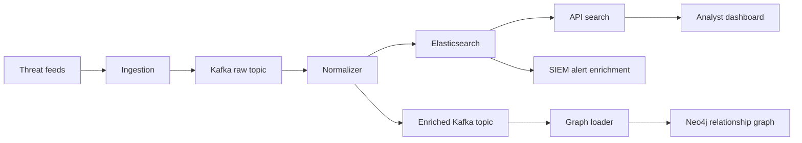

# SentinelFlow

> A threat intelligence operations platform that ingests feeds, enriches alerts, correlates indicators, and serves analyst-facing APIs and dashboards.

## What it is

SentinelFlow is a modular security intelligence stack built around feed ingestion, normalization, enrichment, graph correlation, and response. The repo is structured like a real operations platform, with independent services for each stage of the pipeline.

## Core modules

| Module | Role |
|---|---|
| `ingestion/` | Pulls intelligence from external feeds and normalizes indicator data |
| `entity_graph/` | Loads enriched indicators into Neo4j for relationship analysis |
| `SIEM/` | Enriches alerts and forwards high-value matches to downstream systems |
| `api/` | Flask query layer for indicators, graph neighbors, and stats |
| `dashboard/` | Analyst-facing frontend entry point |

## Data flow

## Stack

| Layer | Stack |
|---|---|
| Messaging | Kafka |
| Search | Elasticsearch |
| Graph | Neo4j |
| API | Flask |
| Containers | Docker Compose |

## Key capabilities

- Indicator normalization and deduplication
- Geo/IP enrichment
- Risk scoring and severity classification
- Graph relationship loading
- Alert enrichment and routing
- Dashboard/API-style analyst access

## Suggested deployment name

**Repo name:** `SentinelFlow`

That name fits the codebase well because the platform is centered on a flow of threat intelligence from ingestion to enrichment to analysis.

## Portfolio description

SentinelFlow is a threat intelligence operations platform that ingests indicators from multiple feeds, enriches and scores them, stores them in Elasticsearch and Neo4j, and exposes the results through a Flask API and analyst dashboard.

## Notes

- The repo is built to look like a real security operations workflow.
- The visual assets above give the README a strong portfolio feel.
- The architecture is modular enough to present cleanly in interviews.
